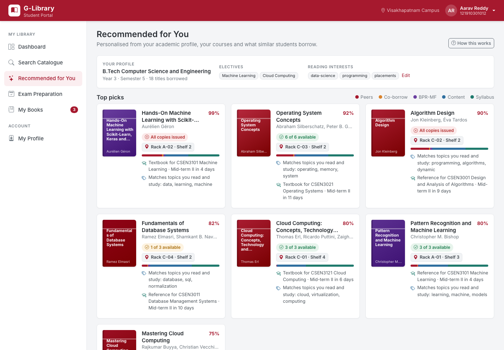
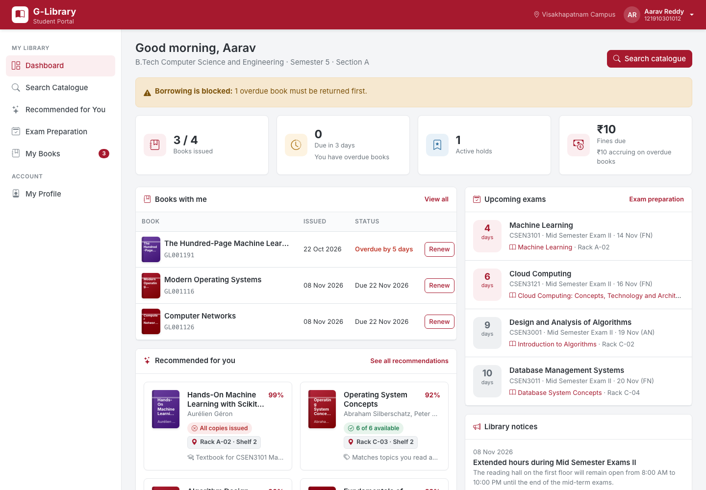
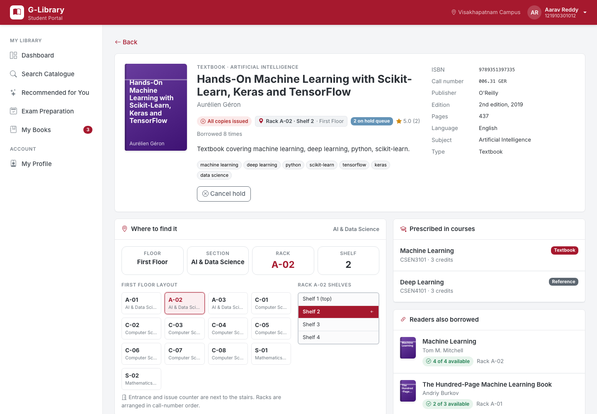
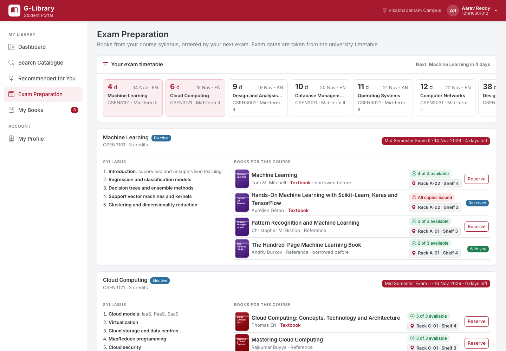
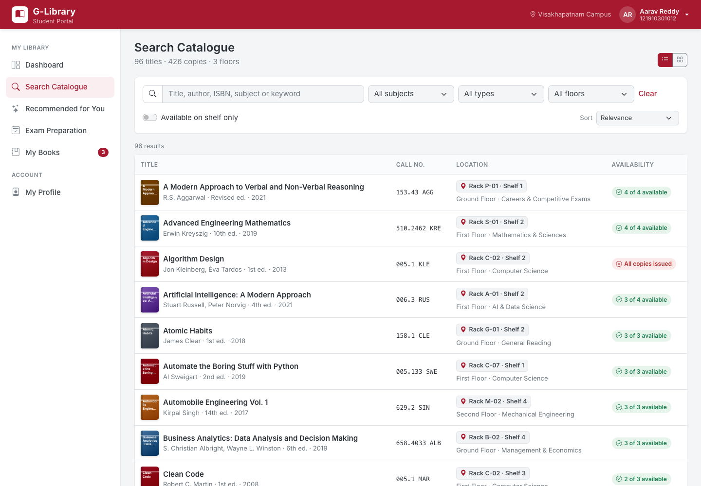
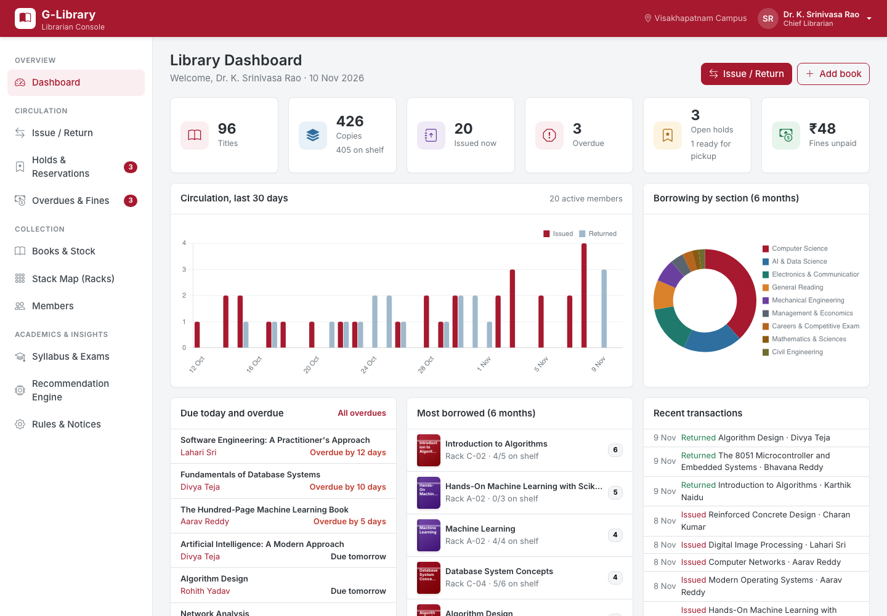
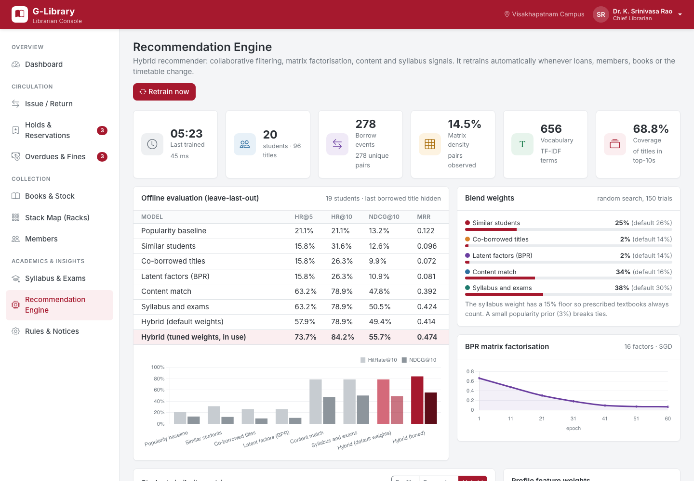
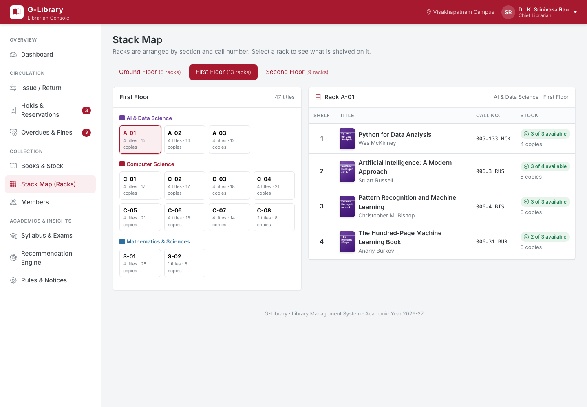
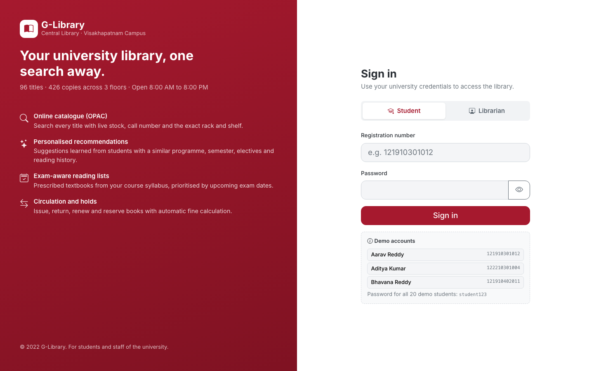
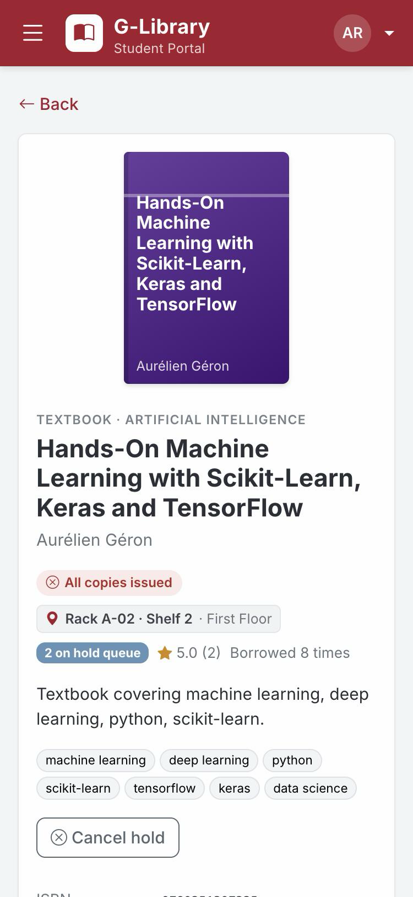

# G-Library

A complete library management system for a university library: an online catalogue with live stock and shelf locations, a student portal, a librarian console for circulation and stock, and a machine-learning book recommender. The recommender learns from student profiles, borrowing history, course syllabi and the exam timetable.

> This application is tailored to GITAM (Visakhapatnam campus) and GITAM students: its programmes, course codes, registration numbers, semester structure, exam pattern (Mid Semester I/II and End Semester) and library layout follow the university's model.

**Live demo:** https://maladisujay.github.io/g-library-app/

## Screenshots

| | |
| --- | --- |
|  |  |
| **Recommended for you**: hybrid ML picks with reasons and signal breakdown | **Student dashboard**: loans, exams, fines and top picks |
|  |  |
| **Book page**: stock, rack and shelf on the floor map | **Exam preparation**: syllabus books ordered by exam date |
|  |  |
| **Catalogue search** with live availability and rack numbers | **Librarian dashboard** |
|  |  |
| **Recommendation engine**: evaluation, tuned weights, similarity | **Stack map**: racks by floor and section |
|  |  |
| **Sign in** for students and librarians | **Mobile layout** |

## Demo accounts

| Role | ID | Password |
| --- | --- | --- |
| Student | `121910301012` (B.Tech CSE, Sem 5) | `student123` |
| Student, new member with no history | `122210301004` (B.Tech CSE, Sem 1) | `student123` |
| Student | `121910402011` (B.Tech ECE, Sem 5) | `student123` |
| Librarian | `LIB001` | `admin123` |
| Assistant librarian | `LIB002` | `admin123` |

All 20 sample students use the password `student123`. The login page lists demo accounts you can fill in with one click.

## Features

### Student portal
- **Dashboard**: books issued, due dates, fines, holds, upcoming exams and top recommendations.
- **Catalogue search (OPAC)**: search by title, author, ISBN, keyword or rack. Filter by subject, type, floor and availability, and sort by relevance, newest, most borrowed or rack order.
- **Book page**: availability ("3 of 5 available"), call number, and floor, section, rack and shelf, shown on a floor layout and a shelf diagram. Also lists every copy with its accession number and status, the courses that prescribe the book, and "readers also borrowed".
- **Recommended for you**: hybrid ML recommendations, each with a match score, a colour bar showing which models contributed, and plain-language reasons. Also shows anonymised "students like you", "because you borrowed…" and what is popular in your programme and semester.
- **Exam preparation**: your exam timetable with countdowns. For each course you get the syllabus units plus its textbooks and references, with live stock, rack location and one-click reservation.
- **My Books**: current loans with renewal, holds with queue position, borrowing history with 1–5 star ratings (used by the recommender), and fines.
- **Profile**: academic details, registered courses and editable reading interests. It also explains which data the recommender uses.

### Librarian console
- **Dashboard**: titles, copies, issued, overdue, holds and unpaid fines. Includes a 30-day circulation chart, borrowing by section, most borrowed titles, due/overdue lists and recent transactions.
- **Circulation desk**: issue, return and renew by registration number and accession number (barcode-scanner friendly). Eligibility checks run automatically: borrowing limit, overdue books, fine limit and reference-only copies. Fines are calculated on return, and returned copies go to the hold shelf when someone is waiting.
- **Books & Stock**: inventory with total, on-shelf, issued and hold counts per title. Add or edit titles, accession new copies, mark copies lost or damaged, switch lending/reference copies, withdraw titles, and export stock to CSV.
- **Stack map**: floors and racks by section; select a rack to see every title, shelf by shelf.
- **Members**: register or edit students (programme, semester, electives, interests). Each member page has loans, history, holds and fines, can suspend or reactivate the member, and shows what the recommender suggests for them.
- **Holds & reservations**: queue management with hold-shelf expiry.
- **Overdues & fines**: overdue list with accruing fines and reminders. The fine register supports collect and waive.
- **Syllabus & exams**: exam timetable editor, the textbooks and references prescribed per course, and import of the exam timetable (CSV) and syllabus (JSON).
- **Recommendation engine**: offline evaluation metrics, tuned blend weights, BPR training loss, a 20×20 student-similarity heatmap (profile, borrowing or hybrid), and a per-student inspector with neighbours and score breakdowns.
- **Rules & notices**: loan period, borrowing limit, renewals, fine rate, fine block limit and hold-shelf period. Notices are published to the student dashboard.

### Circulation rules (defaults, editable)
- Loan period 14 days, up to 4 books per student, 2 renewals.
- Fine of ₹2 per day after the due date. Borrowing is blocked while a book is overdue or unpaid fines exceed ₹100.
- One copy of each title with four or more copies is kept as a reference copy (in-library use).
- A title with a waiting hold cannot be renewed. Ready holds stay on the hold shelf for 3 days.

## Recommendation system

The recommender is a hybrid of five models, trained in the browser in well under a second:

| Signal | Method |
| --- | --- |
| Similar students | User-based k-NN (k = 6). Similarity is a **Gower similarity** over the mixed-type profile (programme, school, semester, age, gender, electives, current and completed courses, interests, CGPA), blended with **cosine similarity of borrowing history**. A shrinkage factor n/(n+4) lets students with little history rely on their profile (cold start). |
| Co-borrowed titles | Item-based collaborative filtering: cosine similarity on the implicit-feedback matrix, with significance shrinkage. |
| Latent factors | **BPR matrix factorisation** (Bayesian Personalised Ranking, 16 factors, SGD). New students are folded in from the latent vectors of similar students. |
| Content match | **TF-IDF** vectors of titles, subjects and keywords, matched against a student profile built from borrowed books, interests and current course syllabi. |
| Syllabus and exams | Prescribed textbooks (1.0) and references (0.75) for the student's registered courses and electives, plus syllabus-text matches. Each is boosted by `1 + 1.5·e^(−days/7)` as that course's next exam approaches. |

Implicit feedback is weighted by renewals, star ratings and recency. Each signal is normalised per student and blended. The blend weights are **tuned automatically** by random search on a **leave-last-out evaluation** (each student's most recent borrow is hidden), measured with HitRate@5/10, NDCG@10 and MRR against a popularity baseline. Final lists are re-ranked with **MMR** for variety, and every recommendation carries human-readable reasons.

The model retrains whenever loans, members, books, the syllabus or the timetable change.

## Sample data

- 20 students across B.Tech CSE, CSE (AI&ML), ECE, Mechanical, Civil and BBA, in semesters 1, 3, 5 and 7, with electives, interests and CGPA.
- 96 titles and 426 copies across 3 floors, 9 sections and 27 racks, each copy with an accession number.
- 60 courses with 5-unit syllabi and prescribed books, and the Mid Semester I/II and End Semester exam timetable.
- Around 280 loans of borrowing history (generated with a seeded random generator, so it is reproducible), plus active loans, overdues, fines, holds and notices.

All dates are relative to the current day so the demo always looks current. Data is stored in the browser's `localStorage`. **Rules & Notices → Reset demo data** restores the original sample.

## Tech stack

- React 18.2 (Create React App 5, function components and hooks)
- React Router 6.4 (hash routing for GitHub Pages)
- Bootstrap 5.2 with React-Bootstrap 2.6, Sass theming, Bootstrap Icons 1.10
- Chart.js 3.9 with react-chartjs-2 4.3
- Recommender written in plain JavaScript (no ML library needed at this data size)
- Jest (via react-scripts) for recommender tests
- GitHub Pages hosting via `gh-pages`

## Project structure

```
src/
  data/            seed data: books and racks, courses and syllabi, students, generator
  services/
    library.js     circulation, holds, fines, catalogue and academic rules
    recommender/   engine (kNN, item CF, BPR, TF-IDF, syllabus), evaluation and tuning
  store/           app state (React context) persisted to localStorage
  components/      layout, book cards, rack locator, shared UI
  pages/           login, student pages, librarian pages
  styles/app.scss  theme
```

## Running locally

```bash
npm install
npm start
```

Open http://localhost:3000.

```bash
npm test          # recommender tests
npm run build     # production build
npm run deploy    # publish build/ to the gh-pages branch
```
